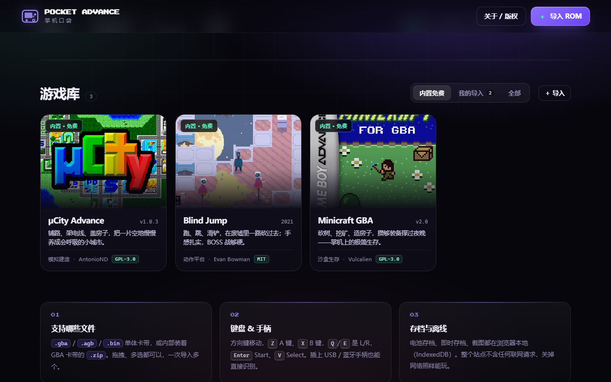
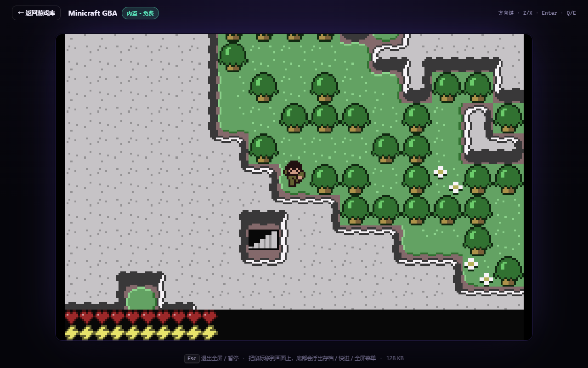
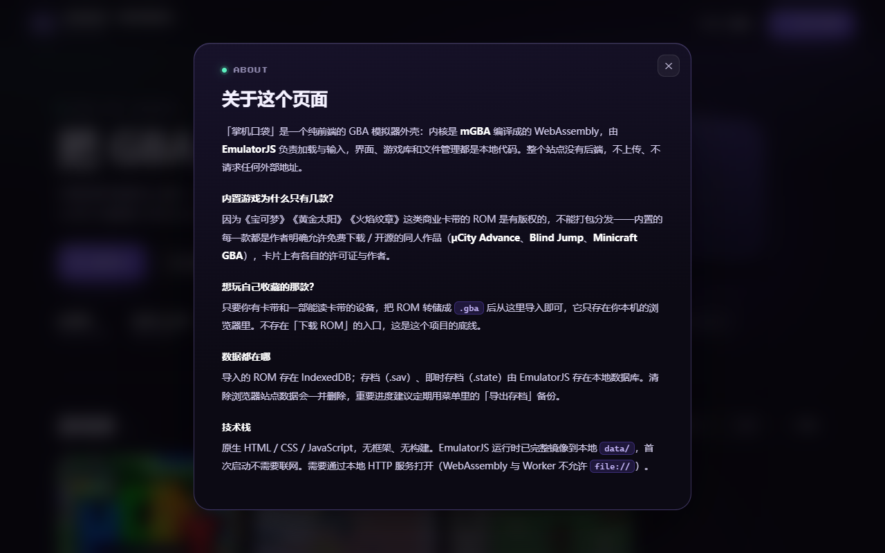
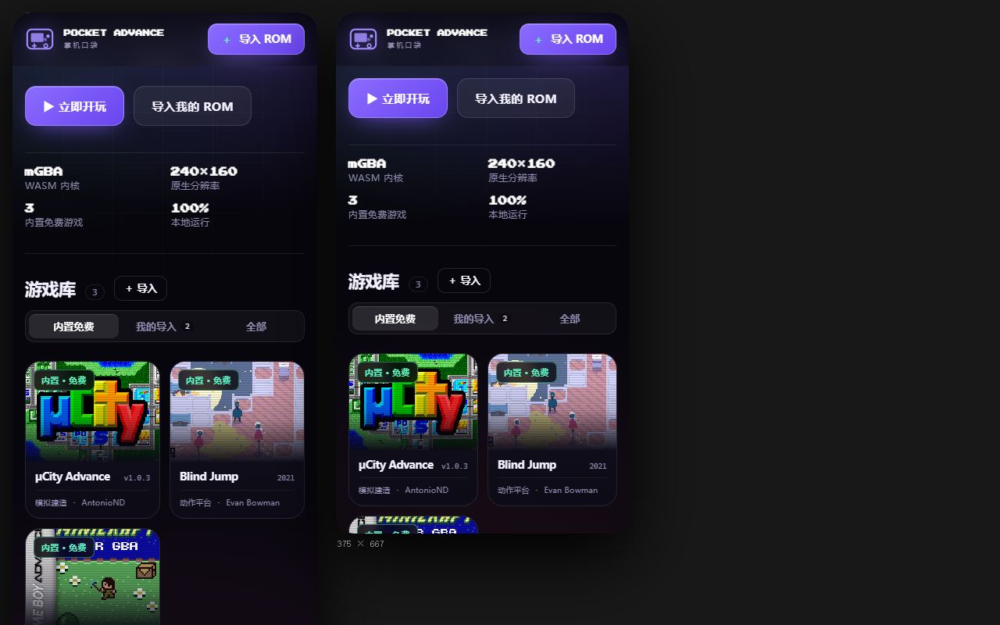

# 掌机口袋 · POCKET ADVANCE

> 一个跑在浏览器里的 GBA 掌机：内置 3 款免费开源的同人游戏，也可以直接打开你自己的 `.gba` / `.zip` 卡带文件。
> 纯前端、无构建、无后端、无外部请求；存档留在本机浏览器。
>
> 仓库：<https://github.com/huangyb7/PocketAdvance>


| 游戏库 | 实机运行 |
|---|---|
|  |  |

| 关于 / 版权 | 手机端（390×844） |
|---|---|
|  |  |

---

## 快速开始

需要 Node.js（或用 Python 也行）。WebAssembly 与 Worker 不允许 `file://`，所以要用本地服务打开，**不能直接双击 `index.html`**。

```bash
# Windows：双击 start.bat（会自动起服务并打开浏览器）
# 或者手动：
cd PocketAdvance
node server.mjs         # → http://127.0.0.1:8123
```

没有 Node 也可以：

```bash
python -m http.server 8123
# 浏览器打开 http://127.0.0.1:8123/
```

`server.mjs` 会自动找 8123 起的空闲端口，并打开默认浏览器；`node server.mjs --no-open` 只起服务。

---

## 能做什么

- **内置 3 款免费游戏**：µCity Advance、Blind Jump、Minicraft GBA，点开即玩，全部本地文件，不联网。
- **导入自己的卡带**：拖拽或点「导入 ROM」，支持 `.gba` / `.agb` / `.bin`，以及内部装着 GBA 卡带的 `.zip`（浏览器内直接解压，不上传）。
- **认得出「假 .gba」**：导入时会按文件头判断真实格式——zip 改名成 `.gba` 会自动解开；7z / rar / gzip 会提示先解压；下载失败存成的网页、空文件、随机数据会给出具体原因，而不是一句「无效文件」。
- **卡带头不标准也能进**：0xB2 没有 `0x96` 标记、但入口是合法 ARM 跳转指令的裁剪版 / 改版 ROM，会带一条黄色提示照常导入。
- **游戏库**：导入的卡带存在 IndexedDB，刷新、关浏览器再打开都还在；卡片可单独移除。
- **完整模拟器控制**：存档 / 读档、电池存档导入导出、快进、音量、金手指、着色器、画面比例、按键重映射、全屏、截图。
- **键盘 / 手柄 / 触屏**：方向键 + `Z` `X` + `Q` `E` + `Enter` `V`；USB / 蓝牙手柄自动识别；手机上自动出现虚拟按键。
- **零外部请求**：EmulatorJS 运行时完整镜像在 `data/`，并主动拦截了 CDN 回退请求，断网也能玩。
- **响应式**：桌面、390×844、375×667 都已验证。

---

## 内置游戏与许可证

| 游戏 | 类型 | 作者 | 许可证 | 来源 |
|---|---|---|---|---|
| µCity Advance | 模拟建造 | AntonioND | GPL-3.0（代码）/ CC BY-NC-SA 4.0（资源） | [GitHub](https://github.com/AntonioND/ucity-advance) |
| Blind Jump | 动作平台 | Evan Bowman | MIT | [GitHub](https://github.com/evanbowman/blind-jump-portable) |
| Minicraft GBA | 沙盒生存 | Vulcalien | GPL-3.0 | [GitHub](https://github.com/Vulcalien/minicraft-gba) |

三款都是作者公开发布、允许免费下载 / 开源的完整游戏，ROM 随项目分发。点卡片右下角的作者名可以访问原项目。

---

## ⚠️ 关于「内置热门 GBA 游戏」

**《宝可梦》《黄金太阳》《火焰纹章》《恶魔城》这类商业卡带的 ROM 受版权保护，本项目不提供、也不会内置或提供下载入口。**

想玩自己收藏的那款，合法路径只有一条：用你自己的卡带 + 读卡设备转储成 `.gba`，然后从这个页面导入。导入的文件只写进你本机的浏览器数据库，不会被上传。

「掌机口袋」的定位是一个**模拟器外壳 + 本地游戏库**，不是 ROM 站。

---

## 目录结构

```text
PocketAdvance/
├─ index.html            入口：主页 / 游戏库 / 播放器 / 关于弹窗
├─ server.mjs            零依赖静态服务器（正确 MIME + Range + no-store）
├─ start.bat             Windows 一键启动
├─ roms/                 内置游戏卡带（3 个 .gba）
├─ art/shots/            内置游戏的实机截图（用作封面）
├─ assets/               图标与像素字体（Press Start 2P, OFL）
├─ css/app.css           全部样式
├─ js/
│  ├─ data.js            内置游戏清单（加游戏改这里）
│  ├─ rom.js             GBA 卡带头解析 + zip 解包
│  ├─ db.js              IndexedDB 封装
│  └─ app.js             路由、渲染、导入、播放器启动
├─ data/                 EmulatorJS 4.2.3 运行时（本地镜像）
│  ├─ loader.js / emulator.min.js / emulator.min.css
│  ├─ cores/mgba*.data   mGBA WASM 内核
│  ├─ compression/       7z/zip/rar 解压模块
│  ├─ localization/      界面语言（含 zh-CN）
│  └─ vendor/fflate.js   zip 解包（MIT）
└─ screenshots/          预览图
```

---

## 怎么加一款内置游戏

1. 把 ROM 放进 `roms/`，截图放进 `art/shots/`；
2. 在 `js/data.js` 的 `BUILTIN_GAMES` 里加一条：

```js
{
  id: "mygame",
  title: "My Game",
  subtitle: "一句话副标题",
  rom: "roms/mygame.gba",
  cover: "art/shots/mygame.png",
  year: "2024",
  genre: "动作",
  author: "作者名",
  license: "MIT",
  blurb: "卡片上的一句介绍。",
  link: "https://github.com/..."
}
```

3. 刷新页面即可。首页的「内置免费游戏」计数会自动更新。

**前提：这款 ROM 必须允许再分发。** 开源 / 免费发布 / 作者明确授权的同人作品可以，商业游戏和来路不明的 ROM 不行。

> `.gitignore` 里 `roms/` 只放行了内置的三款卡带，新增内置游戏时记得把文件名加进白名单；你自己导入 / 转储的 ROM 不会被提交。

---

## 技术说明

- 内核：[mGBA](https://mgba.io/) 编译为 WebAssembly，由 [EmulatorJS](https://emulatorjs.org/)（4.2.3）加载调度。
- 启动流程：点击卡片 → 读取 ROM（内置走 `fetch`，本地走 IndexedDB）→ 生成 Blob URL → 注入 `data/loader.js` → EJS 解压内核、初始化 WASM、加载卡带。
- 存档：EJS 把 `.sav` / `.state` 存进浏览器 IndexedDB；「导出存档文件」可以拿到标准 `.sav`。
- 离线：`data/` 是完整镜像；`js/app.js` 里有一段 `fetch` 白名单，会拒绝任何 `emulatorjs.org` / CDN 请求，避免 EJS 在 localhost 上「检查更新」时联网。
- 换游戏时整页重载：EJS 的内核实例不方便热替换，重载最干净（本地文件，几十毫秒）。
- 安全：所有来自 ROM 头 / 文件名的文本都用 `textContent` 写入，不做 HTML 拼接。

---

## 已知限制

- 必须通过 HTTP 服务打开；`file://` 下 WASM / Worker 会被浏览器挡住。
- 首次进入播放器有点击层：浏览器策略要求一次用户手势才允许 AudioContext 出声。
- 商业游戏的「封面识别 / 自动命名」没有做——那需要游戏数据库，也会变相鼓励盗版。
- 金手指码格式跟随 EJS（GameShark / CodeBreaker 等），输入框在鼠标移到画面后弹出的底部工具条里。
- iOS Safari 没有做真机回归；建议 Chrome / Edge / Android Chrome。

---

## 致谢

- [EmulatorJS](https://github.com/EmulatorJS/EmulatorJS)（GPL-3.0）与 [mGBA](https://github.com/mgba-emu/mgba)（MPL-2.0）：模拟器内核与前端框架。
- µCity Advance、Blind Jump、Minicraft GBA 的各位作者：愿意把作品免费分享出来。
- 字体 [Press Start 2P](https://fonts.google.com/specimen/Press+Start+2P)（SIL OFL 1.1）。

本项目只做界面、游戏库与工程整合，不含任何商业 ROM。
友情赞助链接： https://ifdian.net/a/huangyubin

